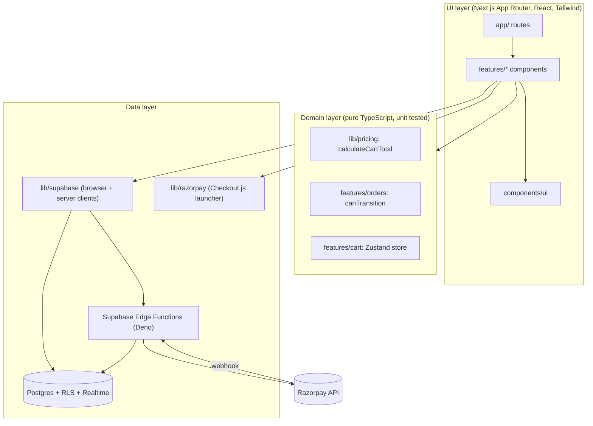
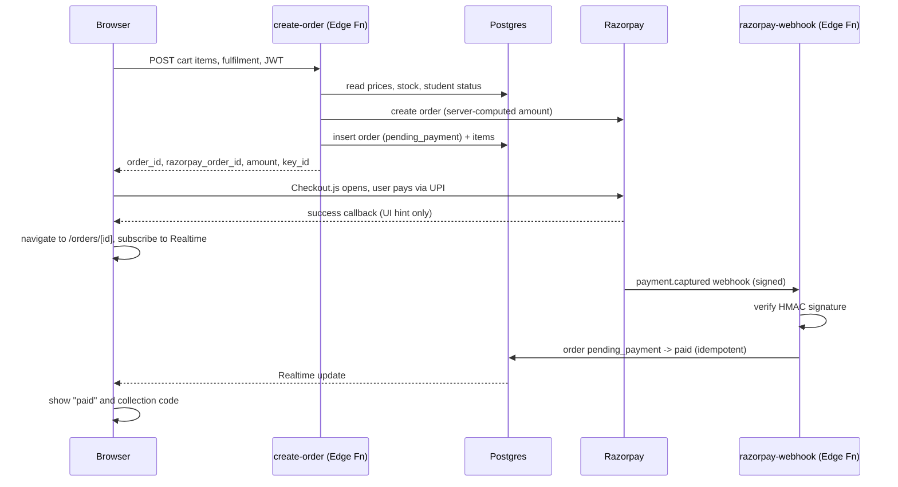

# Architecture: Supermarket ordering app

Status: Phase 1 draft, awaiting approval. No app code exists yet.

## 1. Overview and MVP goals

A mobile-first web app where customers browse a supermarket catalog and order for pickup (default, "in 15 min") or delivery, paying by UPI through Razorpay. Aimed at college students, open to everyone.

MVP goals:
- Browse catalog as a guest; log in with phone OTP at checkout.
- Pickup and delivery orders, paid via Razorpay (UPI).
- 10% discount for students with a verified student ID.
- Live order status with a collection code.
- `/kiosk` route for a store tablet or PC: fullscreen, resets after each order, shows a collection code.
- Phone-first UI; on desktop the app is a centered ~430px column on a neutral background.

Out of scope for MVP: admin panel, rider app, POS sync, loyalty, coupons, native apps, service worker / offline mode. Store staff update order status through the Supabase dashboard or SQL until an admin panel exists.

## 2. Diagrams

### Layers



### Payment flow



## 3. Folder structure

```
supermarket-app/
  app/
    layout.tsx              # 430px container, bottom nav
    page.tsx                # onboarding + home
    product/[id]/page.tsx
    cart/page.tsx
    checkout/page.tsx
    orders/page.tsx
    orders/[id]/page.tsx
    profile/page.tsx
    kiosk/page.tsx
    login/page.tsx
    api/                    # thin route handlers only if needed
  features/
    home/  cart/  checkout/  orders/  profile/  kiosk/
      (components, hooks, domain functions, tests per feature)
  lib/
    supabase/               # browser.ts, server.ts, middleware helper
    razorpay/               # load Checkout.js, open(), types
    pricing/                # calculateCartTotal and tests
  components/ui/            # Button, Card, Chip, Input, BottomNav...
  public/                   # manifest.json, icons
  supabase/
    migrations/  functions/  tests/  seed.sql
  e2e/                      # Playwright
  docs/
```

## 4. Route map

| Route | Purpose | Auth |
|---|---|---|
| `/` | Onboarding (first visit) then home | Public |
| `/product/[id]` | Product detail | Public |
| `/cart` | Cart review | Public |
| `/login` | Phone OTP | Public |
| `/checkout` | Slot or address, pay | Required |
| `/orders` | Order history | Required |
| `/orders/[id]` | Live status, collection code | Required (owner only) |
| `/profile` | Address, student status, logout | Required |
| `/kiosk` | Store kiosk ordering | Public (see section 13) |

Auth is enforced in Next.js middleware (redirect to `/login?next=...`) and again by RLS. Middleware is a UX convenience; RLS is the real gate.

## 5. Supabase schema

All tables have RLS enabled. Money is stored in integer paise. Timestamps are `timestamptz`.

| Table | Columns | Keys | RLS intent |
|---|---|---|---|
| `profiles` | `id uuid`, `phone text`, `full_name text`, `default_address jsonb`, `is_student bool default false`, `created_at` | PK `id` = `auth.users.id` | User reads and updates own row. `is_student` not user-writable (column privilege / trigger). |
| `stores` | `id uuid`, `name`, `address`, `lat`, `lng`, `pickup_eta_minutes int default 15`, `delivery_enabled bool`, `delivery_fee_paise int default 0`, `active bool` | PK `id` | Public read of active stores. No client writes. |
| `categories` | `id uuid`, `name`, `slug`, `sort_order int` | PK `id`, unique `slug` | Public read. No client writes. |
| `products` | `id uuid`, `category_id`, `name`, `description`, `price_paise int`, `mrp_paise int`, `unit text`, `image_url`, `active bool` | PK `id`, FK `category_id`, index `(category_id, active)` | Public read of active. No client writes. |
| `store_stock` | `store_id`, `product_id`, `qty int`, `updated_at` | PK `(store_id, product_id)`, FKs | Public read. No client writes. Decremented by service role on payment. |
| `carts` | `id`, `user_id`, `store_id`, `updated_at` | PK `id`, unique `user_id` | Owner only (select/insert/update/delete). |
| `cart_items` | `cart_id`, `product_id`, `qty int check > 0` | PK `(cart_id, product_id)` | Owner only, via join to `carts`. |
| `orders` | `id`, `user_id`, `store_id`, `status order_status`, `fulfilment ('pickup','delivery')`, `pickup_slot timestamptz`, `delivery_address jsonb`, `subtotal_paise`, `discount_paise`, `delivery_fee_paise`, `total_paise`, `student_discount_applied bool`, `collection_code text`, `razorpay_order_id text unique`, `razorpay_payment_id text`, `created_at`, `updated_at` | PK `id`, index `(user_id, created_at desc)` | Owner select only. No client insert/update; Edge Functions use service role. |
| `order_items` | `order_id`, `product_id`, `name_snapshot`, `unit_price_paise`, `qty` | PK `(order_id, product_id)` | Owner select via join to `orders`. No client writes. |
| `student_verifications` | `id`, `user_id`, `id_image_path text`, `status ('pending','verified','rejected')`, `reviewed_at`, `created_at` | PK `id`, index `user_id` | Owner select. Insert only via `verify-student`. Never client-updated. |

`collection_code`: 4-digit-plus-letter code generated server-side when the order becomes `paid`, unique per store per day.

## 6. Edge Functions

### `create-order`
- **Input:** `{ items: [{product_id, qty}], store_id, fulfilment, pickup_slot?, delivery_address? }`, user JWT.
- **Does:** validates with Zod; loads current prices, stock, and the store's delivery fee from DB (ignores any client price); checks `profiles.is_student` (set only when a `student_verifications` row is `verified`); calls shared pricing logic: 10% student discount on the subtotal, plus the flat delivery fee for delivery orders (pickup has no fee, and the fee is not discounted); creates Razorpay order via API; inserts `orders` (`pending_payment`) and `order_items` snapshots.
- **Output:** `{ order_id, razorpay_order_id, amount_paise, key_id }`.
- **Secrets:** `RAZORPAY_KEY_ID`, `RAZORPAY_KEY_SECRET`, `SUPABASE_SERVICE_ROLE_KEY`.
- **Failures:** 401 no JWT; 400 invalid payload; 409 out of stock or inactive product (returns the offending items); 422 delivery unavailable or slot invalid; 502 Razorpay error (no order row is left behind, or row is marked `cancelled`).

### `razorpay-webhook`
- **Input:** Razorpay POST with `X-Razorpay-Signature`; raw body.
- **Does:** computes HMAC-SHA256 of the raw body with the webhook secret and compares in constant time; on `payment.captured` / `order.paid` finds the order by `razorpay_order_id`; if `pending_payment`, sets `paid`, stores payment id, generates collection code, decrements stock in one transaction. Duplicate events are no-ops. Handles `payment.failed` (leave pending) and `refund.processed` (`refunded`).
- **Secrets:** `RAZORPAY_WEBHOOK_SECRET`, `SUPABASE_SERVICE_ROLE_KEY`.
- **Failures:** bad signature returns 400 and logs; unknown order returns 200 and logs (avoids endless retries); transient DB error returns 500 so Razorpay retries; amount mismatch between payload and `orders.total_paise` marks nothing and alerts via logs.
- Deployed with JWT verification disabled (Razorpay has no Supabase JWT); the signature is the auth.

### `verify-student`
- **Input:** `{ id_image_path }` (path of an ID photo the user already uploaded to the private `student-ids` bucket), user JWT.
- **Does:** checks the file exists under the caller's own folder, inserts a `pending` row. A human reviewer approves in MVP by setting `status='verified'`; a DB trigger then sets `profiles.is_student=true`. Verification is by ID only: no college email is needed, since the app is open to everyone.
- **Output:** `{ verification_id, status: 'pending' }`.
- **Secrets:** `SUPABASE_SERVICE_ROLE_KEY`.
- **Failures:** 401 no JWT; 400 missing or foreign file path; 409 a pending or verified request already exists; 429 too many submissions.

## 7. Payment flow (step by step)

1. User taps Pay on `/checkout`. Browser calls `create-order`.
2. Function reprices from DB and creates the Razorpay order and a `pending_payment` order row.
3. Browser opens Razorpay Checkout.js with `order_id` and `key_id` only.
4. User pays via UPI.
5. Checkout.js success callback fires. The browser treats this as a hint: it clears nothing, marks nothing paid, and navigates to `/orders/[id]`.
6. Razorpay sends a signed webhook to `razorpay-webhook`.
7. The webhook verifies the signature and moves the order to `paid`.
8. `/orders/[id]` is subscribed to Realtime on that order row and updates to "paid" with the collection code. The cart is cleared only when status reaches `paid`.
9. If no webhook arrives within ~30s, the page shows "Confirming your payment" with a manual refresh and support note; it never claims success on its own.

## 8. Order state machine

```
pending_payment -> paid -> received -> packed -> ready_for_pickup -> collected
                                          \-> out_for_delivery -> delivered
pending_payment -> cancelled
paid | received | packed -> cancelled -> refunded
```

Valid transitions (everything else rejected by `canTransition`, mirrored by a DB trigger):

| From | To |
|---|---|
| pending_payment | paid, cancelled |
| paid | received, cancelled |
| received | packed, cancelled |
| packed | ready_for_pickup (pickup only), out_for_delivery (delivery only), cancelled |
| ready_for_pickup | collected |
| out_for_delivery | delivered |
| cancelled | refunded (only if it was paid) |

Terminal: `collected`, `delivered`, `refunded`.

## 9. Auth

- Supabase phone OTP. Guests browse freely; login required at checkout.
- Supabase needs an SMS provider. Plan: **MSG91** (supported by Supabase Auth). For India, SMS senders must register with **TRAI DLT**: register the business (principal entity), a sender header, and the OTP message template; MSG91 requires the DLT entity and template IDs. Registration takes days to weeks, so start early. Until then, development uses Supabase test phone numbers with fixed OTPs.
- Sessions use `@supabase/ssr` cookies so server components and middleware see the user.

## 10. Cart

- Client Zustand store, persisted to localStorage (`cart-v1` key, versioned).
- Stores `{product_id, qty}` plus a display snapshot (name, price, image) for preview.
- On login, local items are merged into `carts` / `cart_items` (sum quantities, cap at stock). After merge the server cart is read back.
- Prices in cart are previews. `create-order` reprices; if totals differ, checkout shows the corrected total before payment opens.

## 11. Offline and error behavior

- Cart survives reloads (localStorage). Catalog pages show a retry state on fetch failure.
- Checkout needs connectivity; the Pay button is disabled with a message when `navigator.onLine` is false.
- Network failure during `create-order`: clear retry button; the request carries an idempotency key so retrying does not create two Razorpay orders.
- Failure after Checkout.js opens: the order stays `pending_payment`; `/orders/[id]` shows "Payment not confirmed" with Retry payment (reopens Checkout.js on the same Razorpay order). Abandoned `pending_payment` orders expire to `cancelled` after 30 minutes (scheduled SQL job).

## 12. Security

- RLS enabled on every table; default deny; policies in migrations and covered by pgTAP.
- Browser uses only the anon key. Razorpay key secret, webhook secret, and service role key exist only in Edge Function secrets (and Vercel server env if a route handler needs them). Only `NEXT_PUBLIC_*` values reach the client bundle.
- HTTPS only; HSTS via Vercel. CSP headers set in `next.config.ts`: allow `checkout.razorpay.com` for script and frame, the Supabase project URL for connect (including `wss:`), self for everything else.
- Webhook signature verified on raw body; constant-time compare.
- Server never trusts client prices, discount flags, or status.
- Zod validation at every Edge Function and route handler boundary.
- Student ID images (if used) go in a private Storage bucket, owner-write, reviewer-read only.

## 13. Kiosk mode

- `/kiosk` is a public route using the same catalog with larger touch targets (min 56px), no customer login. **Assumption:** kiosk orders are created by a Next.js route handler under a dedicated kiosk user, with the store id fixed by env, and paid by Razorpay UPI QR on the kiosk screen; the same webhook marks them paid. Final shape is an open question.
- Fullscreen via the Fullscreen API on first tap; layout ignores the 430px cap and uses full width with the same components.
- Idle timeout: 60s without pointer or key events clears the cart and returns to the start screen (warning at 45s).
- On completion, shows the collection code large for 20s, then resets.
- Deployment: store tablet or PC runs Chrome or Edge in kiosk mode (`--kiosk --app=https://<host>/kiosk`) on a locked OS user account. Browsers cannot lock the device the way Android lock task mode can; exit shortcuts, OS gestures, and navigation away are controlled at the OS level, not by the web app.

## 14. Accessibility and PWA

- Minimum 44px tap targets (56px in kiosk). WCAG AA contrast (4.5:1 text) in both light and dark via CSS variables; visible focus rings; labels on all inputs; sentence-case copy, no emoji.
- `manifest.json` with name, `display: standalone`, theme and background colors, 192 and 512 px icons (plus maskable). Installable to the home screen.
- Service worker is out of scope for MVP.

## 15. Testing strategy

- **Vitest:** `calculateCartTotal` (subtotal, student discount rounding in paise, empty cart), `canTransition` (every valid and a sample of invalid pairs), cart store actions (add, remove, set qty, clear, persistence merge).
- **pgTAP** (`supabase/tests/`): user A cannot read user B's orders or items; anon cannot read orders; clients cannot update orders.
- **Playwright** at 390x844: home -> add to cart -> cart -> checkout page renders. Razorpay is not driven in smoke tests; a separate manual test uses Razorpay test keys and test UPI IDs.
- **Webhook:** local `supabase functions serve` plus a script that signs a sample payload with the test secret and posts it; assert the order moves to `paid` and a replay is a no-op.

## 16. Release plan

- Vercel: preview deployment per PR, production from `main`. Env vars set per environment.
- Supabase: separate **staging** and **production** projects; migrations applied via CLI; Edge Function secrets set per project.
- Razorpay: test mode on staging; production needs completed **KYC** and business verification before live keys.
- Privacy policy page (required before launch and by Razorpay): what is collected (phone number, name, address, student ID data, order history), purpose, processors (Supabase, Razorpay, SMS provider), retention, deletion request process, contact. State that card/UPI details are handled by Razorpay and not stored by us.
- SMS: complete DLT registration and MSG91 setup before enabling phone auth in production.
- Pre-launch checklist: RLS review, webhook configured with production URL and secret, CSP verified, manifest installable on Android and iOS.
